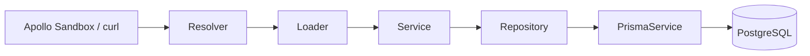
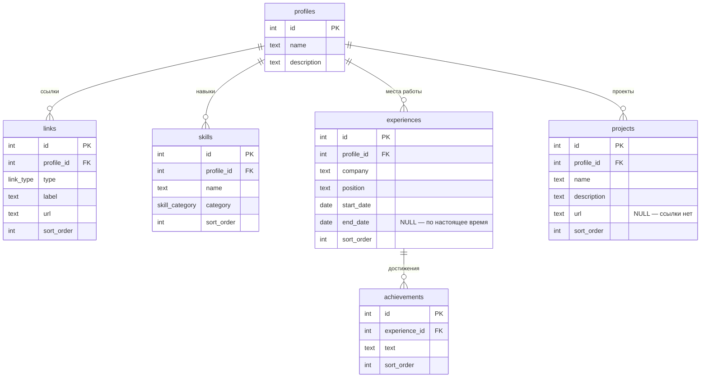
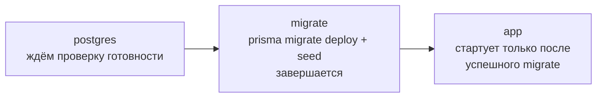

# Цифровая визитка

- **Посмотреть:** <https://109-120-147-30.sslip.io:8443/graphql> — Apollo Sandbox, полный запрос уже подставлен, достаточно нажать **Run**.
- **Исходный код:** <https://github.com/sergeyQe/TestForITSolutions>

Backend-приложение, которое представляет меня как специалиста: профиль, навыки, опыт работы с достижениями и проекты.
Данные отдаёт GraphQL API, интерфейс — **Apollo Sandbox** на `/graphql`.

Стек из задания: **Git · TypeScript · Node.js · NestJS · Prisma · GraphQL · Docker** (плюс PostgreSQL).

- API только на чтение: один корневой запрос `profile`, мутаций и авторизации нет.
- Запуск с нуля одной командой: база создаётся, миграции применяются, данные заливаются автоматически.
- Полный запрос визитки — ровно 6 запросов к базе при любом числе строк; это проверяет тест.
- Схема шире примера запроса из задания: поля сверх него добавлены намеренно (часть — по пунктам требований, часть — для читаемости), обоснование — [в разделе GraphQL API](#graphql-api).

## Содержание

1. [Стек](#стек)
2. [Архитектура](#архитектура)
3. [Схема базы данных](#схема-базы-данных)
4. [GraphQL API](#graphql-api)
5. [Вложенные данные и N+1](#вложенные-данные-и-n1)
6. [Инициализация базы](#инициализация-базы)
7. [Обоснование решений](#обоснование-решений)
8. [Тесты](#тесты)
9. [Деплой](#деплой)
10. [Ограничения](#ограничения)

## Стек

| Технология | Версия | Роль |
|---|---|---|
| Node.js | 24 | среда выполнения; менеджер пакетов — npm |
| TypeScript | 6.0 | весь код; `strict`, без `any`, модули ESM |
| NestJS | 12.5 | модули, внедрение зависимостей, резолверы |
| GraphQL | `graphql` 16.15, `@nestjs/graphql` 14.2 | API; схема строится из кода |
| Apollo Server | 5.5 | сервер GraphQL и Apollo Sandbox |
| Prisma | 7.10.1 | схема базы, миграции, клиент, seed |
| PostgreSQL | 17 | база данных |
| DataLoader | 2.2 | пакетная загрузка вложенных полей |
| zod | 4.6 | проверка настроек окружения при старте |
| Vitest, Testcontainers | 4.1, 12.2 | тесты на настоящей PostgreSQL |
| oxlint, Prettier | — | линтер с проверкой типов, форматирование |
| Docker, Docker Compose | — | сборка образа и запуск: `postgres` → `migrate` → `app` |
| Caddy | 2 | HTTPS на сервере |
| Git | — | история по этапам работы, сообщения в стиле Conventional Commits |

## Архитектура

```
src/
  main.ts                  запуск, корректная остановка по сигналу
  app.module.ts            сборка модулей
  config/                  настройки окружения (zod), настройки GraphQL, текст полного запроса
  prisma/                  PrismaService — единственный экземпляр клиента
  health/                  GET /health
  common/                  скаляр Date, загрузчики на запрос, группировка строк по ключам
  profile/                 профиль и ссылки; корневой запрос profile
  skills/                  навыки; поле Profile.skills
  experience/              места работы и достижения; Profile.experience, Experience.achievements
  projects/                проекты; поле Profile.projects
prisma/
  schema.prisma            схема базы
  migrations/              миграции
  seed-data.ts             данные визитки — единственный источник правды
  seed-database.ts         функция заливки (её же вызывают тесты)
  seed.ts                  обёртка для команды prisma db seed
test/                      тесты на PostgreSQL в контейнере
```

Четыре модуля по областям — `profile`, `skills`, `experience`, `projects` — устроены одинаково: `module / resolver / loader / service / repository / models`.
**Каждый модуль сам объявляет свой кусок графа.** Поле `Profile.skills` объявлено в модуле `skills`, а не в `profile`: модуль профиля ничего не знает о навыках, опыте и проектах, и новую область можно добавить, не трогая его.

### Слои



| Слой | Отвечает за | Не делает |
|---|---|---|
| Резолвер | поля графа; превращает объекты сервиса в модели GraphQL | не обращается к Prisma и к сервису напрямую — данные берёт через загрузчик |
| Загрузчик | собирает обращения одного запроса GraphQL в пакет, вызывает пакетный метод сервиса, раскладывает строки по родителям | не содержит правил предметной области |
| Сервис | правила предметной области: строка периода работы, «по настоящее время», «профиль не найден» | не знает ни о GraphQL, ни о Prisma; возвращает простые объекты |
| Репозиторий | запросы Prisma: только нужные поля (`select`), сортировка, пакетные выборки `WHERE … IN (…)` | не содержит правил предметной области |

Модели GraphQL и модели Prisma — разные типы. Служебные поля (идентификаторы, внешние ключи, номер для сортировки) в API не попадают; тип строки репозитория выводится из его `select`, а не описывается вручную.

Бизнес-логики в визитке мало, и я не стал раздувать её искусственно: сервисы навыков и проектов просто передают данные дальше. Слой оставлен ради единой границы: правило, которое появится завтра, ляжет в сервис, а не в резолвер или запрос.

## Схема базы данных



- У каждой дочерней таблицы — внешний ключ с индексом и каскадным удалением. Индекс нужен пакетным выборкам `WHERE profile_id IN (…)`.
- Порядок показа задаёт `sort_order`, а не идентификатор: порядок — это данные, а не побочный эффект вставки.
- Даты периода хранятся типом `date` (без времени), всегда первое число месяца: точность периода — месяц.
- `link_type` и `skill_category` — перечисления PostgreSQL; они же зарегистрированы в схеме GraphQL, второй раз вручную не описаны.
- Достижения — отдельная таблица, а не массив строк: это второй уровень вложенности, на котором и возникает задача N+1.
- Схема меняется только миграциями (`prisma/migrations`).

## GraphQL API

Схема целиком — в файле [`schema.gql`](schema.gql): её можно прочитать, не запуская приложение. У всех типов и полей есть описания — они видны в документации Sandbox.

```graphql
type Query {
  profile: Profile!
}

type Profile {
  name: String!
  description: String!
  links: [Link!]!
  skills: [Skill!]!
  experience: [Experience!]!
  projects: [Project!]!
}

type Link        { type: LinkType!  label: String!  url: String! }
type Skill       { name: String!  category: SkillCategory! }
type Project     { name: String!  description: String!  url: String }
type Achievement { text: String! }

type Experience {
  company: String!
  position: String!
  startDate: Date!          # дата без времени, ГГГГ-ММ-ДД
  endDate: Date             # null — работает по настоящее время
  period: String!           # «02.2026 – 10.2026» или «02.2026 – по настоящее время»
  achievements: [Achievement!]!
}
```

Запрос из задания работает дословно. В Sandbox по умолчанию подставлен **полный запрос** — он же, дополненный ссылками и достижениями:

```graphql
query Profile {
  profile {
    name
    description
    links { type label url }
    skills { name category }
    experience {
      company
      position
      period
      startDate
      endDate
      achievements { text }
    }
    projects { name description url }
  }
}
```

**Что в схеме сверх примера из задания.** Запрос из задания назван примером («например»), а его поля покрывают не все пункты списка. Поэтому схема шире него, и это сделано намеренно:

| Поля | Почему есть |
|---|---|
| `links`, `achievements`, `period`, `Project.url` | Прямо перечислены в требованиях: ссылки профиля (п. 1), достижения и период работы (п. 3), ссылка на проект (п. 4). В примере запроса их нет, но без них пункты не выполнены |
| `Skill.category` | Навыков два десятка. Категории (языки, backend, данные, архитектура, инфраструктура, тестирование) делают список читаемым, а порядок «навыки одной категории подряд» задаётся при заполнении базы. Это перечисление у навыка, а не отдельная таблица, и уровня владения нет. Запрос `skills { name }` работает как есть |
| `startDate`, `endDate` | Это исходные данные, из которых сервис считает `period`. Клиент может сортировать и считать стаж, не разбирая строку. `endDate = null` означает «по настоящее время». Точность — месяц, дата хранится без времени |
| `Project.description` | Визитка презентует специалиста: одного названия мало. У внутренних систем, например IoT-сервиса сбора данных со станков, публичной ссылки нет (`url` — `null`), и без описания запись о проекте пустая |

Дополнительные поля ничего не меняют для запроса из задания: он выполняется дословно и обходится четырьмя запросами к базе (это проверяет тест).

**Ошибки.** Трассировка стека и тексты ошибок базы наружу не уходят ни в каком окружении:

| Ситуация | Что получает клиент |
|---|---|
| база не заполнена | `NOT_FOUND`, «Профиль не найден: база данных не заполнена» |
| ошибка в тексте запроса | `GRAPHQL_PARSE_FAILED` / `GRAPHQL_VALIDATION_FAILED` |
| операция, которой нет в схеме (например, мутация) | `BAD_REQUEST` |
| непредвиденный сбой (например, база недоступна) | `INTERNAL_SERVER_ERROR`, «Внутренняя ошибка сервера»; подробности — только в журнале |

## Вложенные данные и N+1

Задача: у профиля есть места работы, у каждого места — достижения. Наивный резолвер `Experience.achievements` делает по запросу к базе на каждое место работы: одно обращение за списком и N за вложенными данными.

Решение — **DataLoader**. Вложенное поле не идёт в базу само, а обращается к загрузчику. Загрузчик собирает все обращения одного шага выполнения запроса и делает один `SELECT … WHERE experience_id IN (…)`, после чего раскладывает строки по родителям в порядке ключей; родитель без детей получает пустой список.

Число SQL-запросов на один запрос GraphQL (измерено по журналу запросов):

| Запрос | Без загрузчиков | С загрузчиками |
|---|---|---|
| Полный запрос (3 места работы) | 8 | **6** |
| Дословный запрос из задания | 4 | 4 |
| `profile { name }` | 1 | 1 |
| Полный запрос при 1003 местах работы | 1008 (по формуле 5 + N) | **6** |
| 100 повторов `profile` под псевдонимами, все поля | 800 | **6** |

Шесть запросов — по одному на таблицу: профиль, ссылки, навыки, места работы, достижения, проекты. Число не зависит от количества строк. Читаются только запрошенные поля: в запросе из задания нет ссылок и достижений — и их таблицы не трогаются.

Честная оговорка: профиль в базе один, поэтому на первом уровне (навыки, проекты, места работы) выигрыша от пакетной загрузки нет — там и так по одному запросу. Реальный выигрыш — на достижениях и при повторе корневого поля под псевдонимами.

**Загрузчик живёт один запрос.** DataLoader запоминает загруженное, поэтому общий на всё приложение экземпляр отдавал бы данные одного запроса другому. Класс [`RequestLoaders`](src/common/request-loaders.ts) создаёт загрузчик при первом обращении и привязывает его к объекту контекста запроса через `WeakMap`: Apollo создаёт новый контекст на каждый запрос, а вместе с контекстом сборщик мусора забирает и загрузчик. Каждый модуль держит свои загрузчики у себя — общего списка «всех загрузчиков приложения» нет.

Увидеть запросы своими глазами: `docker compose logs app` — при `LOG_QUERIES=true` (по умолчанию в compose) каждый SQL-запрос пишется в журнал.

## Инициализация базы

`docker compose up --build` запускает три сервиса по цепочке:



- **`migrate` — отдельный одноразовый контейнер**, а не команда в запуске приложения. Если миграция упала, приложение не стартует вовсе (а не падает в цикле перезапусков); в образе приложения нет ни Prisma CLI, ни исходников; при нескольких экземплярах приложения миграции всё равно выполнятся один раз.
- **Seed повторяемый.** Данные визитки лежат в одном файле — [`prisma/seed-data.ts`](prisma/seed-data.ts). Функция заливки в одной транзакции удаляет прежнюю визитку и вставляет содержимое файла: повторный запуск не создаёт дубликатов и не оставляет строк, которых в файле уже нет. Чтобы изменить визитку, достаточно поправить файл и перезапустить `docker compose up`.
- **Образ собирается в несколько стадий.** `migrate` берётся из стадии сборки (в ней Prisma CLI, `tsx`, миграции и данные), `app` — из лёгкой стадии: только `dist`, зависимости для работы и `package.json`; `NODE_ENV=production`, пользователь `node`, а не root. Контейнер приложения запускается с файловой системой только для чтения и без привилегий (`cap_drop: ALL`, `no-new-privileges`).
- Приложение при старте проверяет базу запросом `SELECT 1`: без базы оно завершается с понятной ошибкой, и Docker перезапускает его. По сигналу остановки закрывает соединения и завершается само.
- Пароль базы задаётся в одном месте — `POSTGRES_PASSWORD`; адрес базы для `migrate` и `app` compose собирает из тех же переменных. Порт базы наружу не публикуется.

## Обоснование решений

| Решение | Почему | Что рассматривал |
|---|---|---|
| **Prisma 7** (7.10.1, версии закреплены) | последняя стабильная. Новый генератор `prisma-client` кладёт типизированный клиент в `src/generated` как обычный ESM-код, подключение — через адаптер `@prisma/adapter-pg`, настройки CLI — в `prisma.config.ts` | Prisma 6 — старый генератор в `node_modules`; Prisma 8 — пока предрелиз, хотя метка `latest` в npm указывает на него |
| **Схема GraphQL из кода** (code-first) | один источник правды — классы TypeScript: типы резолверов и схема не расходятся; описания полей живут рядом с кодом. `schema.gql` хранится в репозитории, чтобы схему можно было прочитать без запуска | schema-first — схему и типы пришлось бы сводить генерацией |
| **Четыре модуля, каждый объявляет свои поля графа** | граница модуля совпадает с границей области; `profile` не зависит от остальных | один модуль на всё; все поля `Profile` в одном резолвере — он знал бы обо всех областях |
| **Слои Resolver → Loader → Service → Repository** | у каждого слоя одна причина меняться: схема API, пакетная загрузка, правила, запросы к базе | резолвер, работающий с Prisma напрямую, — меньше кода, но правила и запросы смешиваются с API |
| **DataLoader на запрос, привязка через `WeakMap`** | грузятся только запрошенные поля, каждый уровень — один SQL; без приведения типов и без утечки | `include` по списку полей из `info` — резолвер привязывается к структуре базы; `include` всего — лишние данные на каждый запрос; провайдеры с областью «на запрос» — Nest пересоздаёт цепочку зависимостей на каждый запрос; общий список загрузчиков в контексте — знал бы обо всех модулях |
| **Отдельные модели GraphQL** | наружу не уходят идентификаторы, внешние ключи и `sort_order`; схему базы можно менять, не меняя API | отдавать модели Prisma как есть |
| **Период работы считает сервис, только в UTC** | это правило предметной области, а не оформление. Дата без времени в местном поясе западнее Гринвича сдвинулась бы на предыдущий месяц | форматирование в резолвере или на клиенте |
| **Собственный скаляр `Date`** | встроенные `DateTime` и `Timestamp` несут время, которого в данных нет; полтора десятка строк вместо новой зависимости | `graphql-scalars`; строковое поле без типа |
| **Миграции в отдельном контейнере** | см. [Инициализация базы](#инициализация-базы) | миграции в команде запуска приложения; `prisma db push` — без истории изменений схемы |
| **Seed: удаление и вставка в одной транзакции** | файл данных — единственный источник правды, база всегда равна ему | `upsert` по строкам — естественных ключей нет, а удалённые из файла строки остались бы в базе |
| **Настройки окружения — схема zod** | одна схема даёт и проверку при старте, и тип настроек; при ошибке приложение не стартует и называет переменную | Joi, `class-validator`. Глобальный `ValidationPipe` не подключён: входных данных у API нет |
| **Sandbox и схема открыты в продакшене** | это требование задания: Sandbox и есть интерфейс визитки. Данные публичные, API только на чтение | — |
| **Потолок размера запроса — 1000 токенов** | раз схема открыта, одним запросом нельзя повторить корневое поле тысячи раз. Обратных ссылок в схеме нет, поэтому глубина запроса ограничена самой схемой | своё правило проверки запроса; сторонние библиотеки оценки сложности |
| **Тесты на настоящей PostgreSQL** | проверяемые свойства — число SQL-запросов, порядок строк, повторяемость seed — существуют только в базе; заглушки проверяли бы сами себя | тесты сервисов на заглушках |
| **`/health` — простой контроллер с `SELECT 1`** | нужен проверке состояния контейнера; пределы ожидания базы — 5 с, зависшая база даёт 503, а не бесконечное ожидание | `@nestjs/terminus` — лишняя зависимость ради одной проверки |
| **ESM, TypeScript 6, oxlint, Vitest** | так устроен шаблон NestJS 12, клиент Prisma 7 тоже ESM. TypeScript не обновлён до 7: её не поддерживает `@nestjs/graphql` | CommonJS; ESLint |
| **Caddy для HTTPS** | сертификат получает и продлевает сам, вся настройка — пять строк | nginx + certbot |

Две оговорки по настройкам:

- В `tsconfig.json` выключена `strictPropertyInitialization` (остальной `strict` включён): поля классов-моделей GraphQL заполняются не в конструкторе, а альтернатива — оператор `!` у каждого поля.
- В `package.json` есть `overrides` для двух транзитивных зависимостей (`@graphql-tools/utils` и `glob`): без них `npm audit` сообщает об уязвимостях в коде, который приложение не вызывает, а исправленные версии не входят в диапазоны, объявленные `@apollo/server` и `archiver-utils`.

## Тесты

```bash
npm ci
npm test
```

Нужен запущенный Docker: Testcontainers поднимает PostgreSQL 17 в контейнере, схема создаётся теми же миграциями, приложение запускается целиком, запросы идут по HTTP. От локальной базы и файла `.env` тесты не зависят.

Четыре теста — по одному на свойство, которое легко сломать незаметно:

1. **Полный запрос возвращает все вложенные данные в порядке показа.** В тестовом наборе есть место работы без достижений (пустой список) и без даты окончания («по настоящее время»). Порядок проверяется отдельно: номера сортировки переворачиваются — списки должны прийти в обратном порядке. Тесты идут в часовом поясе западнее Гринвича, чтобы форматирование даты не в UTC сразу проявилось.
2. **Полный запрос — ровно 6 запросов к базе**, в том числе после добавления двадцати мест работы с достижениями; дословный запрос из задания — 4.
3. **`profile { name }` — 1 запрос к базе.**
4. **Повторный seed не создаёт дубликатов.**

Число запросов считается по событиям `query` клиента Prisma. Каждый тест проверен порчей кода: без сортировки, без пакетной загрузки, с форматированием в местном поясе, с seed без удаления — соответствующий тест падает.

## Деплой

Развёрнутый экземпляр: <https://109-120-147-30.sslip.io:8443/graphql>. Порт 8443 в адресе — потому что порт 443 на этом сервере занят другой службой. Проверка без браузера:

```bash
curl -s https://109-120-147-30.sslip.io:8443/graphql -H "content-type: application/json" -d '{"query":"{ profile { name description skills { name } experience { company position } projects { name } } }"}'
```

Сервер — VPS с Docker. Используется тот же `docker-compose.yml`, что и локально, плюс дополнение [`docker-compose.prod.yml`](docker-compose.prod.yml): контейнер **Caddy** получает сертификат и принимает HTTPS, порт приложения наружу не публикуется.

На сервере в `.env` задаются три переменные:

```bash
POSTGRES_PASSWORD=надёжный-пароль-из-букв-и-цифр
SITE_ADDRESS=card.example.com
LOG_QUERIES=false
```

```bash
docker compose -f docker-compose.yml -f docker-compose.prod.yml up -d --build
```

Пароль базы применяется при первом создании тома с данными; без `POSTGRES_PASSWORD` и `SITE_ADDRESS` запуск на сервере остановится с понятной ошибкой. `docker-compose.prod.yml` требует Docker Compose 2.24 или новее.

Если порт 443 на сервере занят другой службой, в `.env` добавляется `HTTPS_PORT` (например, `8443`): Caddy принимает HTTPS на этом порту, сертификат получает через порт 80, а адрес сайта становится `https://card.example.com:8443`.

Что добавляет серверное дополнение помимо HTTPS: заголовки безопасности в Caddy (HSTS, `X-Content-Type-Options`, запрет встраивания страницы во фрейм, `Referrer-Policy`), предел памяти приложения, ограничение размера журналов контейнеров; у Caddy из привилегий оставлена одна — занять порты 80 и 443.
`postgres`, `app` и `caddy` перезапускаются автоматически (в том числе после перезагрузки сервера), `migrate` выполняется один раз при каждом запуске.

## Ограничения

- **Нет мутаций, авторизации и пагинации.** Визитка — данные на чтение; меняются они правкой `prisma/seed-data.ts` и повторным запуском. Списки — десятки строк, страницы им не нужны.
- **Профиль один.** Запрос `profile` без аргументов берёт первый профиль; seed гарантирует, что он единственный.
- **Бизнес-логики мало** — только период работы и «профиль не найден». Слои показывают границы ответственности, а не объём логики.
- **Нет ограничения частоты запросов.** В стандартной сборке Caddy его нет, а собирать свой образ ради визитки на чтение я не стал. Размер одного запроса ограничен (1000 токенов, тело до 100 КБ): корневое поле можно повторить под псевдонимами около полутора сотен раз — база при этом читается один раз, но ответ растёт пропорционально числу повторов.
- **Приложение подключается к базе той же ролью, что и миграции.** Отдельной роли только на чтение нет: входных данных у API нет, порт базы наружу закрыт, а лишняя роль усложнила бы запуск одной командой.
- **Интерфейс Sandbox загружается с серверов Apollo.** Из закрытой сети он может не открыться; API при этом работает: тот же запрос уходит обычным POST на `/graphql`, например через `curl`.
- **Каждый `docker compose up` перезаливает данные.** Запрос, попавший ровно в момент фиксации транзакции seed, может получить пустые вложенные списки; следующий запрос вернёт полные данные.
